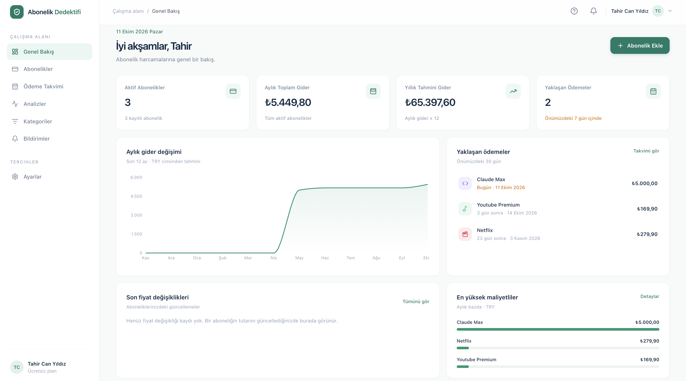

# Abonelik Dedektifi 🕵️

Tüm aboneliklerinizi tek yerden takip edin: ödeme tarihlerini kaçırmayın, aylık ve
yıllık giderlerinizi anlık görün, fiyat artışlarını yakalayın, deneme süreleri
bitmeden haberdar olun.



## İçindekiler

- [Özellikler](#özellikler)
- [Teknoloji yığını](#teknoloji-yığını)
- [Nasıl çalışır?](#nasıl-çalışır)
- [Yerel kurulum](#yerel-kurulum)
- [Ortam değişkenleri](#ortam-değişkenleri)
- [Supabase kurulumu (hosted)](#supabase-kurulumu-hosted)
- [Bildirim cron'u](#bildirim-cronu)
- [Testler](#testler)
- [Deployment (Vercel)](#deployment-vercel)
- [Proje yapısı](#proje-yapısı)
- [Güvenlik](#güvenlik)

## Özellikler

### 📊 Genel Bakış (Dashboard)
- Aktif abonelik sayısı, aylık toplam ve yıllık tahmini gider kartları
- Son 12 ayın **gerçek verilerden türetilmiş** gider trendi — abonelik başlangıç
  tarihleri, iptal tarihleri ve fiyat geçmişi birlikte hesaplanır
- Önümüzdeki 30 günün yaklaşan ödemeleri ("Bugün", "Yarın", "3 gün sonra" etiketli)
- Son fiyat değişiklikleri ve aylık bazda en maliyetli abonelikler

### 💳 Abonelik yönetimi
- Ekleme, düzenleme, abonelik detayı, iptal, duraklatma/devam ettirme, arşivleme
  ve kalıcı silme (onay diyaloglarıyla)
- Ada/sağlayıcıya göre anlık arama, kategori ve durum filtreleri, çoklu sıralama
- Alanlar: ad, sağlayıcı, kategori, tutar + para birimi (TRY/USD/EUR/GBP),
  faturalandırma sıklığı (haftalıktan yıllığa + özel gün aralığı), başlangıç ve
  sonraki ödeme tarihi, otomatik yenileme, durum, deneme bitişi, açıklama,
  hatırlatma tercihleri
- Sonraki ödeme tarihi; başlangıç tarihi ve sıklığa göre otomatik önerilir

### 🧮 Maliyet hesaplama
Bağımsız, saf ve birim testli bir modülde ([`lib/cost.ts`](lib/cost.ts)):

| Döngü      | Aylık eşdeğer formülü          |
| ---------- | ------------------------------ |
| Haftalık   | tutar × 52 / 12                |
| Aylık      | tutar                          |
| Üç aylık   | tutar / 3                      |
| Altı aylık | tutar / 6                      |
| Yıllık     | tutar / 12                     |
| Özel       | tutar × 365.2425 / gün / 12    |

- İptal edilmiş, süresi dolmuş ve duraklatılmış abonelikler toplamlara girmez
- **Farklı para birimleri asla toplanmaz** — her biri ayrı gösterilir
- Ödeme tarihleri başlangıç gününe "çıpalıdır": 31 Ocak'ta başlayan aylık abonelik
  28 Şubat'a kayar ama Mart'ta yine 31'ine döner (kayma/drift yoktur); artık yıllar
  ve saat dilimi (Europe/Istanbul) doğru ele alınır

### 📅 Ödeme takvimi
- Aylık ızgara görünümünde tüm ödeme günleri, bugün vurgusu, kategori renkleri
- Ay içindeki ödemelerin listesi ve para birimine göre ay toplamları
- İleri/geri ay gezinmesi

### 📈 Analizler
- Kategori dağılımı (halka grafik + yüzdeli dökümü)
- Para birimi başına aylık/yıllık toplam kartları
- 12 aylık gider trendi ve faturalandırma sıklığı dağılımı
- Tüm fiyat değişikliklerinin tarihçesi

### 🏷️ Fiyat geçmişi
- Abonelik tutarı değiştiğinde eski fiyat, yeni fiyat, değişim tarihi, artış/azalış
  yüzdesi ve isteğe bağlı kullanıcı notu otomatik kaydedilir
- Kayıtlar değiştirilemez (veritabanında UPDATE politikası bilinçli olarak yok)
- Fiyat değişiminde otomatik uygulama içi bildirim üretilir

### 🔔 Bildirimler
- Ödeme öncesi hatırlatmalar: 7 gün / 3 gün / 1 gün önce ve ödeme günü
  (abonelik başına seçilebilir)
- Deneme süresi bitiş hatırlatmaları
- Uygulama içi bildirim merkezi: okundu işaretleme, tümünü okundu yapma, silme
- İsteğe bağlı e-posta bildirimleri (Resend) — profilden açılıp kapatılabilir
- Güvenli cron endpoint'i; `dedupe_key` unique indeksi sayesinde aynı bildirim
  asla iki kez üretilmez

### 👤 Hesap
- Kayıt, giriş, çıkış, e-posta doğrulama, şifre sıfırlama/değiştirme
- Profil düzenleme: ad, varsayılan para birimi, e-posta bildirim tercihi
- Güvenli hesap silme (onay metniyle; tüm veriler cascade ile temizlenir)

## Teknoloji yığını

| Katman    | Teknoloji                                         |
| --------- | ------------------------------------------------- |
| Framework | Next.js 16 (App Router, Server Actions), React 19 |
| Dil       | TypeScript (strict)                               |
| Stil      | Tailwind CSS v4                                   |
| Backend   | Supabase (PostgreSQL, Auth, Row Level Security)   |
| Grafikler | Recharts                                          |
| Doğrulama | Zod (sunucu tarafı)                               |
| E-posta   | Resend (isteğe bağlı)                             |
| Test      | Vitest (70 birim testi), Playwright (18 E2E testi) |
| CI        | GitHub Actions (lint + typecheck + test + build + E2E) |

## Nasıl çalışır?

- **Veri akışı:** Sayfalar React Server Component olarak doğrudan Supabase'den
  okur; yazma işlemleri Server Action'lar üzerinden yapılır ve her girdi sunucuda
  Zod şemalarıyla doğrulanır.
- **Oturum:** `@supabase/ssr` ile cookie tabanlı oturum; `proxy.ts` (Next 16
  middleware) her istekte oturumu tazeler, `/app/*` rotalarını korur ve girişli
  kullanıcıyı auth sayfalarından uygulamaya yönlendirir.
- **Veri izolasyonu:** Tüm tablolarda owner-only RLS politikaları vardır;
  kullanıcı yalnızca kendi satırlarını görebilir/değiştirebilir. Bu, E2E testinde
  iki ayrı tarayıcı oturumuyla ayrıca doğrulanır.
- **Yeni kullanıcı:** Kayıt anında veritabanı tetikleyicisi profil + 8 varsayılan
  kategori oluşturur.
- **Vade ilerletme:** Cron her çalıştığında vadesi geçen otomatik yenilenen
  abonelikleri bir sonraki vadeye taşır; yenilenmeyenleri `expired` yapar.

## Yerel kurulum

Gereksinimler: Node.js 20+ (22 önerilir), pnpm, Docker (yerel Supabase için).

```bash
# 1. Bağımlılıkları kur
pnpm install

# 2. Yerel Supabase'i başlat (migration'lar otomatik uygulanır)
pnpm exec supabase start

# 3. Ortam değişkenlerini yaz
cp .env.example .env.local
# `pnpm exec supabase status` çıktısındaki API URL / anon key / service_role key
# değerlerini .env.local içine girin.

# 4. Geliştirme sunucusu
pnpm dev
```

| Servis                 | Adres                   |
| ---------------------- | ----------------------- |
| Uygulama               | http://localhost:3000   |
| Supabase Studio        | http://localhost:54323  |
| Mailpit (yerel e-posta) | http://localhost:54324 |

> Yerel ortamda e-posta doğrulaması kapalıdır; kayıt sonrası doğrudan giriş
> yapılır. Şifre sıfırlama e-postaları Mailpit'e düşer.

## Ortam değişkenleri

| Değişken                        | Zorunlu    | Açıklama                                                                  |
| ------------------------------- | ---------- | ------------------------------------------------------------------------- |
| `NEXT_PUBLIC_SUPABASE_URL`      | Evet       | Supabase proje URL'i                                                      |
| `NEXT_PUBLIC_SUPABASE_ANON_KEY` | Evet       | Public (anon) anahtar                                                     |
| `SUPABASE_SERVICE_ROLE_KEY`     | Cron için  | Service role anahtarı — **yalnızca sunucuda**, asla istemciye sızdırmayın |
| `CRON_SECRET`                   | Cron için  | Hatırlatma endpoint'ini koruyan rastgele uzun değer (`openssl rand -hex 32`) |
| `RESEND_API_KEY`                | Hayır      | E-posta bildirimleri için Resend anahtarı                                 |
| `EMAIL_FROM`                    | Hayır      | Gönderen adresi, örn. `Abonelik Dedektifi <bildirim@domain.com>`          |
| `NEXT_PUBLIC_SITE_URL`          | Önerilir   | E-posta bağlantıları için uygulamanın temel URL'i                         |

## Supabase kurulumu (hosted)

1. [supabase.com](https://supabase.com) üzerinde yeni proje oluşturun.
2. **Settings → API**'den URL ve anahtarları alıp `.env.local`'a (ve Vercel ortam
   değişkenlerine) girin.
3. Migration'ları uygulayın:

   ```bash
   pnpm exec supabase link --project-ref <proje-ref>
   pnpm exec supabase db push
   ```

   Alternatif: `supabase/migrations/` altındaki SQL dosyalarını sırasıyla
   SQL Editor'da çalıştırın.
4. **Authentication → URL Configuration**'da Site URL'i ve
   `https://<site>/auth/callback`, `https://<site>/auth/confirm` redirect
   URL'lerini ekleyin.

### Veritabanı şeması

| Tablo           | İçerik                                                        |
| --------------- | ------------------------------------------------------------- |
| `profiles`      | Ad, varsayılan para birimi, e-posta bildirim tercihi           |
| `categories`    | Kullanıcıya özel kategoriler (renk + ikon)                     |
| `subscriptions` | Abonelikler: tutar, döngü, tarihler, durum, hatırlatmalar      |
| `price_history` | Değiştirilemez fiyat değişikliği kayıtları                     |
| `notifications` | Uygulama içi bildirimler (`dedupe_key` unique indeksli)        |

Tamamında owner-only RLS, foreign key'ler ve indeksler tanımlıdır. Hesap silme
`delete_own_account()` RPC'si ile yapılır (auth.users silinir, veriler cascade
ile temizlenir).

## Bildirim cron'u

`GET /api/cron/reminders` — `Authorization: Bearer $CRON_SECRET` başlığı ister
(timing-safe karşılaştırma). Günde bir çağrıldığında:

1. Vadesi geçen otomatik yenilenen abonelikleri sonraki vadeye taşır,
   yenilenmeyenleri `expired` yapar.
2. Hatırlatma bildirimlerini üretir; `dedupe_key` sayesinde idempotenttir —
   aynı gün tekrar çağrılsa bile bildirim tekrarlanmaz.
3. `RESEND_API_KEY` tanımlıysa, e-posta bildirimi açık kullanıcılara e-posta atar.

Vercel'de `vercel.json` içindeki cron tanımı her gün 06:00 UTC'de çalışır;
Vercel, `CRON_SECRET` ortam değişkeni tanımlıysa isteği otomatik olarak doğru
başlıkla gönderir. Vercel dışında herhangi bir zamanlayıcıyla da tetiklenebilir:

```bash
curl -H "Authorization: Bearer $CRON_SECRET" https://<site>/api/cron/reminders
```

## Testler

```bash
pnpm test        # Vitest birim testleri
pnpm test:e2e    # Playwright E2E (dev sunucusunu kendisi başlatır)
pnpm lint        # ESLint
pnpm typecheck   # TypeScript
pnpm build       # Production build
```

- **Birim testleri (70):** maliyet formülleri, ay sonu/artık yıl/saat dilimi
  tarih senaryoları, fiyat değişim yüzdeleri, para birimi ayrımı, abonelik durum
  kuralları, form şemaları, hatırlatma ve vade ilerletme mantığı
- **E2E testleri (18):** kayıt/giriş/çıkış, yanlış şifre, yetkisiz erişim engeli,
  RLS veri izolasyonu (iki ayrı kullanıcı), abonelik ekleme/düzenleme/iptal/silme,
  arama ve filtreler, fiyat değişikliği + geçmiş + bildirim, takvim, kategori
  yönetimi

E2E testleri için önce `pnpm exec supabase start` ile yerel stack'in ayakta ve
`.env.local`'ın dolu olması gerekir.

## Deployment (Vercel)

1. Depoyu Vercel'e bağlayın (framework otomatik algılanır).
2. Ortam değişkenlerini ekleyin: `NEXT_PUBLIC_SUPABASE_URL`,
   `NEXT_PUBLIC_SUPABASE_ANON_KEY`, `SUPABASE_SERVICE_ROLE_KEY`, `CRON_SECRET`,
   `NEXT_PUBLIC_SITE_URL` (+ isteğe bağlı Resend değişkenleri).
3. Supabase Authentication ayarlarındaki Site URL / Redirect URL'leri production
   alan adıyla güncelleyin.
4. Deploy edin — cron tanımı otomatik devreye girer.

## Proje yapısı

```
app/
  (auth)/             # giriş, kayıt, şifre sıfırlama/yenileme sayfaları
  app/                # korumalı uygulama
    page.tsx          #   genel bakış (dashboard)
    abonelikler/      #   liste, yeni, [id] detay, [id]/duzenle
    takvim/           #   aylık ödeme takvimi
    analizler/        #   grafikler ve fiyat geçmişi
    kategoriler/      #   kategori yönetimi
    bildirimler/      #   bildirim merkezi
    profil/           #   profil, şifre, hesap silme
  actions/            # Server Actions (auth, abonelik, kategori, bildirim)
  api/cron/reminders/ # zamanlanmış hatırlatma endpoint'i
  auth/               # e-posta doğrulama / OAuth callback route'ları
components/
  app/                # uygulama bileşenleri (kabuk, formlar, grafikler)
  auth/               # auth form bileşenleri
  ui/                 # temel UI (input, toast, dialog, badge, ...)
lib/
  cost.ts             # maliyet hesaplama (saf, test edilebilir)
  dates.ts            # tarih/vade hesaplama (ay sonu, artık yıl, çıpa)
  reminders.ts        # hatırlatma ve vade ilerletme mantığı
  schemas.ts          # Zod doğrulama şemaları
  supabase/           # browser/server/admin istemcileri + DB tipleri
proxy.ts              # oturum tazeleme + rota koruması (Next 16 middleware)
supabase/migrations/  # veritabanı şeması + RLS politikaları
tests/unit/           # Vitest
tests/e2e/            # Playwright
.github/workflows/    # CI (lint, typecheck, test, build, E2E)
```

## Güvenlik

- Tüm tablolarda **Row Level Security**: kullanıcılar yalnızca kendi kayıtlarına
  erişebilir (gerçek Postgres üzerinde ve E2E ile test edilmiştir)
- Tüm form girdileri **sunucu tarafında** Zod ile doğrulanır; kategori sahipliği
  ayrıca kontrol edilir
- Service role anahtarı yalnızca sunucu modüllerinde kullanılır; `server-only`
  importu yanlışlıkla istemci paketine girmesini derleme hatasıyla engeller
- Cron endpoint'i timing-safe secret karşılaştırmasıyla korunur
- Giriş sonrası yönlendirmelerde open-redirect koruması vardır
- Şifre sıfırlama, hesabın var olup olmadığını sızdırmaz
- Gizli anahtarlar repoya girmez (`.env*.local` gitignore'dadır)
